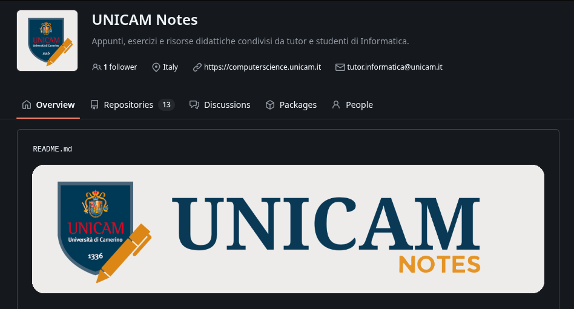
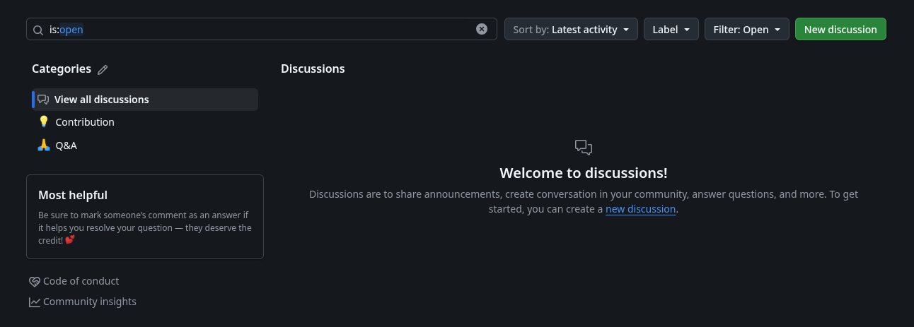
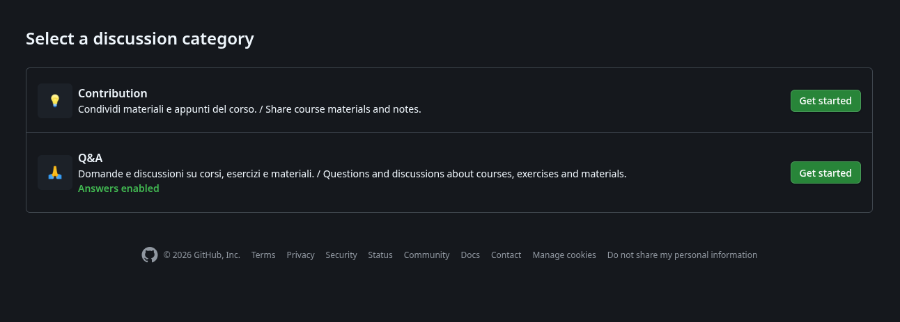

# Contributing

[Italiano](../../CONTRIBUTING.md) · English

Students and tutors can share PDF notes, ZIP archives containing folders or materials, exercises, solutions, Markdown documents and other files relevant to the course.

## Where to contribute

Report errors and corrections through **Issues in the relevant course repository**, including the file or link, the problem and, if possible, a suggested correction. No dedicated template is needed.

Pull requests must be opened in the specific course repository. Discussions must be opened only in the [central UNICAM Notes space](https://github.com/orgs/unicam-notes/discussions).

## Choose how to contribute

- **Q&A**: questions and general discussions about courses, exercises or materials, including ideas and requests for clarification.
- **Contribution**: new materials. Specify the course or module, describe the content and add attachments or links.
- **Issues in the course repository**: errors in existing materials. Identify the file or link and describe the error; suggest a correction if possible.

Use the [central Discussions space](https://github.com/orgs/unicam-notes/discussions) for all courses and identify the relevant course or repository. Pull requests go to course repositories; materials can also be proposed as attachments in central Discussions. Both active forms have Italian and English labels and instructions: you can complete them in either language. Enter the title in GitHub’s native title field.

GitHub only accepts attachments within supported formats and limits: not every PDF or ZIP can necessarily be uploaded. If an attachment is rejected, share an accessible link or submit a pull request to add the files to the repository. A link does not replace permission to distribute the material.

## Share files in a message

1. Open the [UNICAM Notes organization page](https://github.com/unicam-notes) and click **Discussions** in the top bar, next to **Repositories**.

2. Click **New discussion**.

3. Choose **Contribution** to share files or **Q&A** to ask a question, then click **Get started**.

To share materials, open **New discussion → Contribution**, enter a title and write your message naming the course. Drag supported files directly into the message, paste images or add links. A pull request is not required to propose materials through a Discussion; attachments are not automatically added to the course repository.

## Pull requests

1. Open the course repository and create a fork if needed.
2. Add or edit files in the relevant folder, following the existing structure and conventions. Use descriptive names and avoid duplicates or unnecessary reorganizations. You can use GitHub’s editor and file upload interface.
   * Any LaTeX notes must be placed in a dedicated folder named `latex/AcademicYear - FirstName LastName/`, containing a precompiled `.pdf` file and the corresponding source code inside a `source/` subfolder.
4. Open a pull request with a brief description, crediting the original author and source in the material or in a README next to the files. Maintainers will review it.

## Authors, rights and licensing

Only share your own material or material you have the right or permission to distribute. Always credit the original author when known and the source, with a link when available; retain signatures, credits, provenance and copyright notices. Do not publish personal data without consent.

All UNICAM Notes repositories use the [BSD 3-Clause](../../LICENSE). Every contribution must comply with its terms; by submitting original materials, you agree to make them available under this license. For content covered by it, retain the copyright, conditions and disclaimer in source distributions; reproduce them in the documentation or other supplied materials for binary distributions. Do not use the copyright holder’s or contributors’ names to endorse derived products without written permission.

Check the license of the course repository and individual materials. Uploading third-party content does not automatically make it BSD 3-Clause or grant missing rights.

Follow the [code of conduct](CODE_OF_CONDUCT.md).
