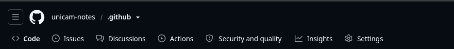

# UNICAM Notes

[Italiano](../../README.md) · English

Notes, exercises and teaching materials shared by students and tutors at the University of Camerino. Browse the [course repositories](../../profile/README.md) to find materials.

## Join the Discussions

[Discussions](https://github.com/unicam-notes/.github/discussions) are the shared space for all courses. You can write in Italian or English.

In this repository’s top bar, click **Discussions**, then **New discussion** and choose a category:

- **Q&A**: ask a question or start a conversation.
- **Contribution**: share notes, exercises and other materials.

To share a file, choose **New discussion → Contribution**, name the course and drag the file into your message. You can also paste images or add links. If GitHub rejects an attachment, share a link. No pull request is needed; attachments are not automatically added to the course repository.

## Corrections and changes

- Report errors by opening an **Issue in the course repository**, with a material link and a brief description.
- To add or edit repository files directly, submit a **pull request in that same repository**.

## Respect the authors

All repositories use the [BSD 3-Clause](../../LICENSE). Original contributions are shared under this license. Only publish materials you have the right to distribute, and retain authors, sources and copyright notices. Third-party materials retain their own restrictions.

[Contribution guide](CONTRIBUTING.md) · [Code of conduct](CODE_OF_CONDUCT.md)

Maintainer setup

Keep `.github` public and publish the forms on its default branch. Enable Discussions only here, with **Q&A** (question/answer, slug `q-a`) and **Contribution** (open-ended discussion, slug `contribution`). Files in `.github/DISCUSSION_TEMPLATE/` must match the slugs: verify the fields by starting a new discussion. To display this space at organization level, select `.github` as the Discussions source repository. Enable Issues in course repositories. Before removing existing categories, move or transfer relevant discussions.

