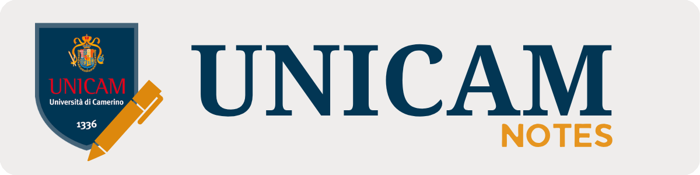

**UNICAM Notes** offre appunti, esercitazioni e materiali di tutorato per gli insegnamenti di Informatica. I contenuti sono organizzati per percorso di laurea e anno di studio, con un repository dedicato a ciascun corso. Chiunque può contribuire condividendo i propri appunti, aggiungendo materiali o proponendo correzioni tramite una pull request/Discussion nel repository del corso interessato. 
 <em>Espandi un anno e scegli un corso per accedere al relativo repository.</em>
 
---
<h2 align="center"> — Laurea Triennale — </h2>

### I anno

Mostra / nascondi corsi

| Corso | Repository |
| --- | --- |
| Programmazione | [ST0851](https://github.com/unicam-notes/ST0851-Programmazione) |
| Matematica Generale | [ST0821](https://github.com/unicam-notes/ST0821-MG) |
| Calcolo delle Probabilità e Statistica | [ST0253](https://github.com/unicam-notes/ST0253-CPS) |
| Fondamenti di Informatica | [ST0247](https://github.com/unicam-notes/ST0247-FDI) |
| Architettura degli Elaboratori | [SST0068](https://github.com/unicam-notes/SST0068-ADE) |
| Business e Management nell'Information Technology | [ST0856](https://github.com/unicam-notes/ST0856-BMIT) |
| Diritto dei Prodotti Digitali | N/A |
| Comunicazione e Marketing Digitale | N/A |

### II anno

Mostra / nascondi corsi

| Corso | Repository |
| --- | --- |
| Algoritmi e Strutture Dati | [ST0853](https://github.com/unicam-notes/ST0853-ASD) |
| Internet, Reti e Sicurezza | [SST0069](https://github.com/unicam-notes/SST0069-IRS) |
| Sistemi Operativi | [ST0830](https://github.com/unicam-notes/ST0830-SO) |
| Metodologia (e Strumenti) di Programmazione | [SST0138](https://github.com/unicam-notes/SST0138-MSP) |
| Basi di Dati | [ST0266](https://github.com/unicam-notes/ST0266-BD) |
| Ricerca Operativa | [ST0302](https://github.com/unicam-notes/ST0302-RO) |
| User Experience Design | [ST1411](https://github.com/unicam-notes/ST1411-UXD) |
| Social Media Management | [ST1412](https://github.com/unicam-notes/ST1412-SMM) |
| Grafica per la Comunicazione Digitale | [ST1416](https://github.com/unicam-notes/ST1416-GCD) |

### III anno

Mostra / nascondi corsi

| Corso | Repository |
| --- | --- |
| Ingegneria del Software | [ST0496](https://github.com/unicam-notes/ST0496-IDS) |
| Paradigmi Avanzati di Programmazione | [ST1420](https://github.com/unicam-notes/ST1420-PAP) |
| Linguaggi e Compilatori | [ST1344](https://github.com/unicam-notes/ST1344-LC) |
| Applicazioni Web, Mobile e Cloud | [ST1417](https://github.com/unicam-notes/ST1417-AWMC) |
| Game Design | [ST1418](https://github.com/unicam-notes/ST1418-GD) |

<h2 align="center"> — Master's Degree — </h2>

### I year

Coming soon ...

### II year

Coming soon ...

